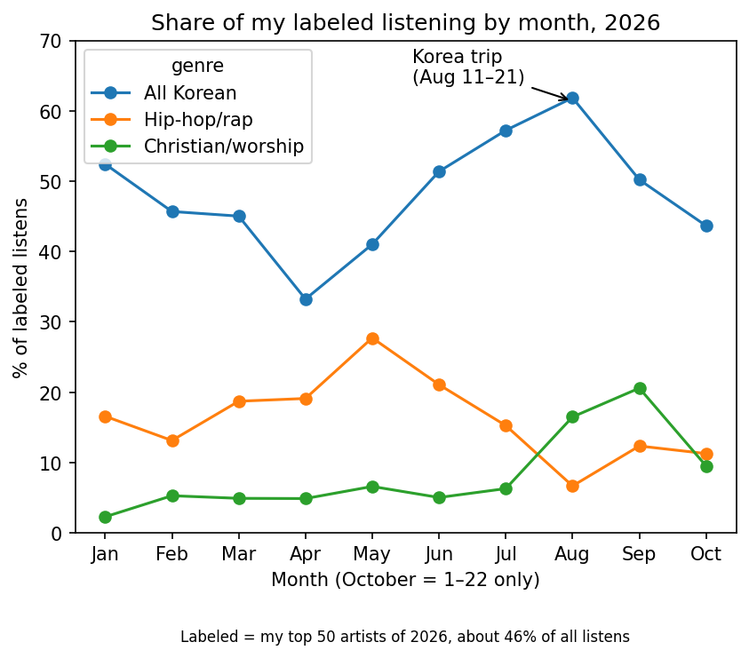
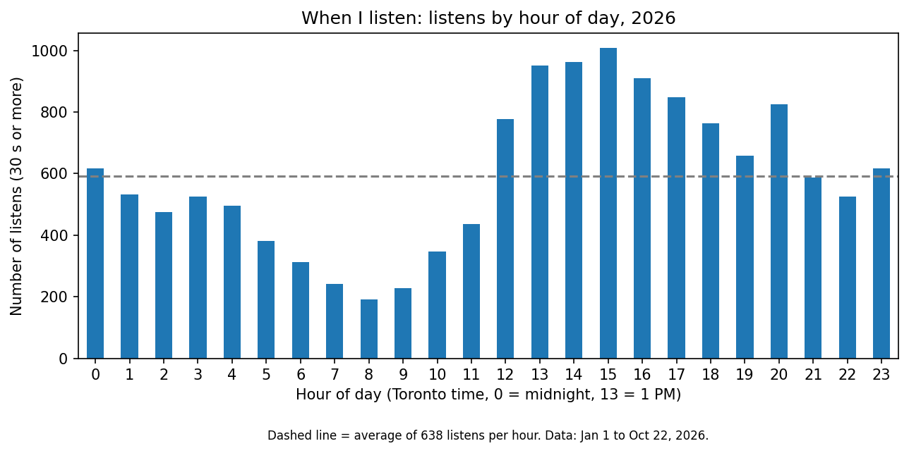
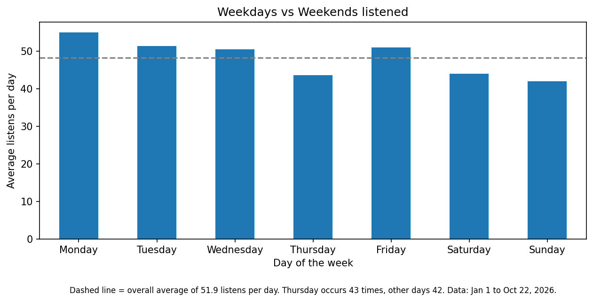

# How My Spotify Listening Changed (2022–2026)

## What I wanted to find out

I want to work in music data and market intelligence, and analyzing my own Spotify history was a way to practice turning real streaming data into findings, and to see how well my memory matches what the data shows. I wanted to see what percentage of my listening went to certain artists and genres, and to test whether questions I've asked myself were true, such as "Do I listen to a lot of K-pop?", "Which artists have I been listening to this year, compared with other years?", and "Did my trip to Korea change what I listened to?"

## The data

The data came from Spotify after I requested my Extended Streaming History. It arrived in a zip folder with 18 JSON files covering November 2020 to October 22, 2026. I chose to start my analysis in 2022, because my listening jumped from about 13,000 plays in 2021 to over 47,000 in 2022. After keeping only plays of 30 seconds or more, I have a total of 89,496 listens from January 2022 to October 22, 2026. Many of the analyses focus on 2026 (15,308 listens), based on my own curiosity and personal discovery: genres by month, top songs, when I listen during the day and week, and my Korea trip. The raw data is not included, as the files contain personal account information.

## How I cleaned it

1. Combined all 18 files into one table of 253,882 rows.
2. Removed 36 exact duplicate rows.
3. Kept only 5 columns (time, track, artist, time played, skipped), which also removed my IP address.
4. Converted timestamps from UTC to Toronto time, because Spotify records times in UTC. Without converting, a song I played at 9 PM would have been counted at 1 or 2 AM, and all my time-of-day results would be shifted 4–5 hours.
5. Kept only plays of at least 30 seconds, following Spotify's own threshold for counting a stream, to remove plays that were quick skips.
6. Removed 276 listens with no track or artist name, which were most likely podcasts.
7. Kept only listens from January 2022 onward, leaving 89,496 listens.

## What I found

**1.** ENHYPEN was my #1 artist in 4 of the 5 years from 2022 to 2026. The exception was 2024, when Shin Giwon Piano was #1 with 1,317 listens.

**2.** In 2026, my #1 song was "Knife" by listens (59 listens), but "BTS Cypher Pt.3: Killer" by minutes (228 minutes), because each play lasted about twice as long. Which song counts as my "favourite" depends on how you measure it.

**3.** Among my top 50 artists of 2026, Korean music (K-pop, K-R&B, K-hip-hop, K-indie) fell to 33.4% of my listening in April, while hip-hop rose to 19.7% in April and peaked at 28.7% in May; Korean music then climbed to a peak of 61.4% in August, the month of my trip to Korea.

**4.** From 2022 on, 57–68% of plays each year lasted under 30 seconds, which surprised me. Most of my plays were short, probably quick skips, so counting every play would have let songs I barely heard push up my rankings; that's why I only counted plays of 30 seconds or more. To check my 30-second rule, I tried a 60-second cutoff: it changed each year's count by only 6–11% and gave the same ranking of years, so my results don't depend on the exact cutoff.

**5.** From midnight to 9 AM, Shin Giwon Piano was about 5.0% of my 2026 listens vs. about 2.2% for the rest of the day. I put piano on at bedtime and leave it playing while I sleep, and each play is recorded when it ends, so the plays pile up overnight and into the morning. This means my late-night listening and Shin Giwon Piano's rank as my #2 artist are probably inflated: a play isn't always a listen.

### More charts

In 2026, my listening peaked in the afternoon, with 1,103 listens at 3 PM, and was lowest at 8 AM (199 listens); surprisingly, I listened more at midnight than at any hour of the morning.

## Limitations

- Sleep playback counts as listening. Spotify records songs that play while I'm asleep, so my plays are probably higher than my real, active listening.
- Genre labels only cover my top 50 artists (about 46% of 2026 listens), so the genre shares may not represent all of my listening.
- 2026 ends on October 22, so it's a partial year, and its totals can't be compared directly with full years like 2025.

## What I'd do next

Next, I'd like to separate sleep playback from active listening, for example by leaving out piano plays between midnight and 9 AM, and see how my rankings change. I'd also repeat the analysis once 2026 is complete, so I can compare full years fairly.

## Files

- `spotify_listening_analysis.ipynb`: the full analysis in Python and pandas (Google Colab)
- `genre_share_2026.png`, `listens_by_hour_2026.png`, `listens_by_weekday_2026.png`: charts

To rerun the notebook, request your own Extended Streaming History from Spotify and put the `Streaming_History_Audio_*.json` files in a Google Drive folder called `spotify_project`.
